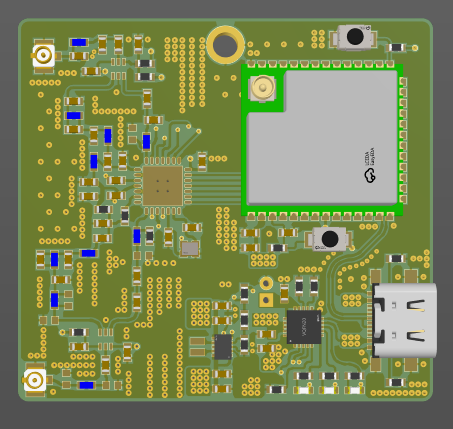
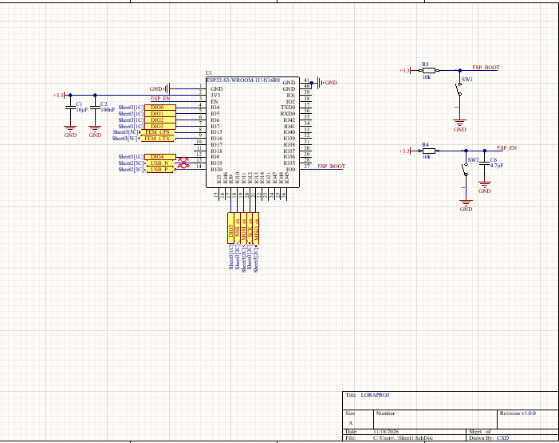
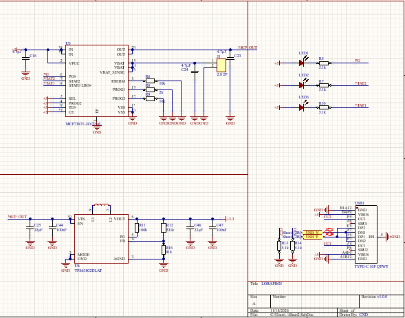
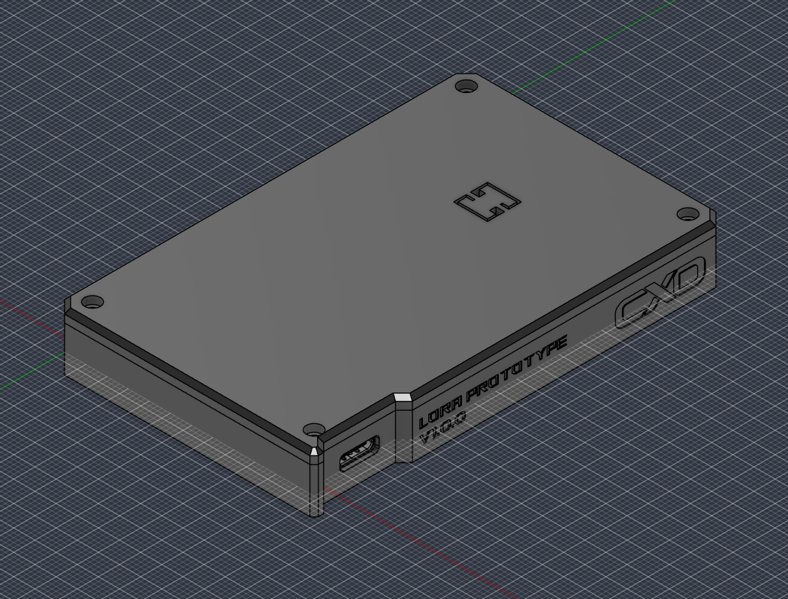

# loraproj
This project aims to be a convent way to enable Lora communication on any mobile device wirelessly. Connect to the Lora device using BLE or to its wifi connection. It aims to enable all kinds of P2P features from messaging to gaming.
This project was a unqiue way to explore RF circuits.

##
Features:
- ESPRESSIF ESP S3 N16R8 (2.5ghz + BLE)
- SEMTECH SX1276 (DUAL SUB GHZ LORA 915mhz +  470mhz - use in accordance to regulations use in your jurisdiction)
- Wireless connectivity to mobile devices via wifi AP mode or BLE website application
- Long battery life ~1000mah battery using Microchip MCP73871
- USC 5V power input
- Compact and slim device ~13mm width
- Magsafe compatible

## PCB

#

## SCHEMATICS

## HOUSING

## BOM
View the BOM at [bom.csv](pcb/bom/bom[set].csv).

#
Changlog MMDDYYYY  
11/17/2026: RELEASE
#
Made for HC Fallen 2026
