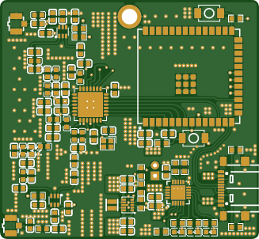
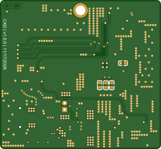
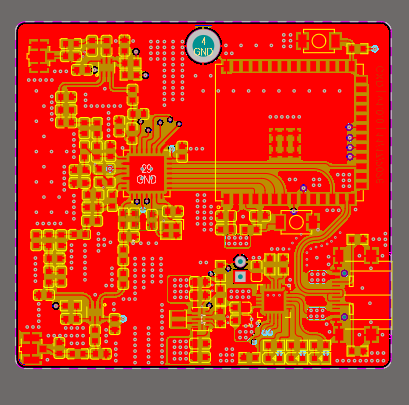
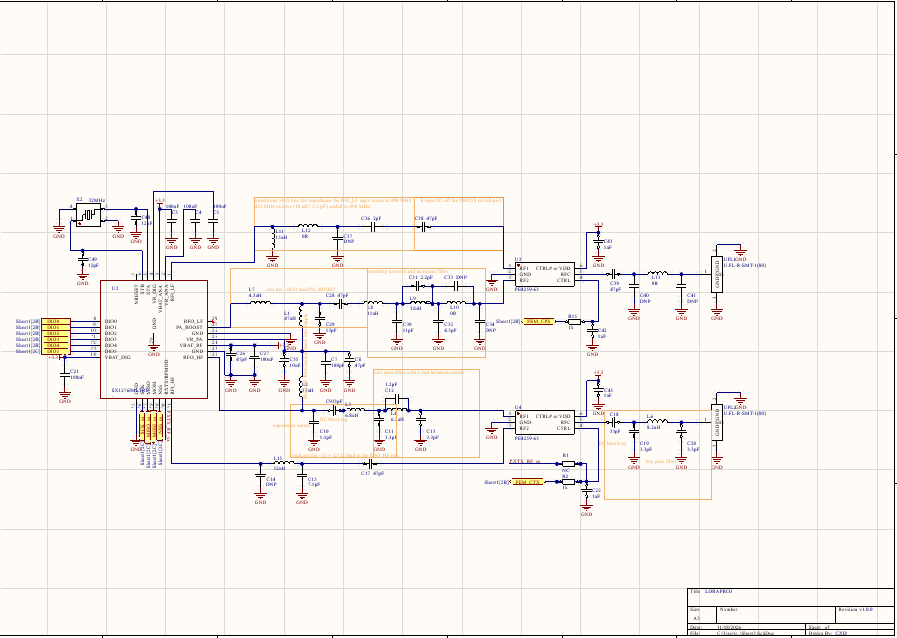

# loraproj
This project aims to be a convent way to enable Lora communication on any mobile device wirelessly. It aims to enable all kinds of P2P features from messaging to gaming.
This project was a unqiue way to explore RF circuits.
## PCB

#

## SCHEMATICS

## BOM
View the BOM at [bom.csv](pcb/bom/bom[set].csv).
